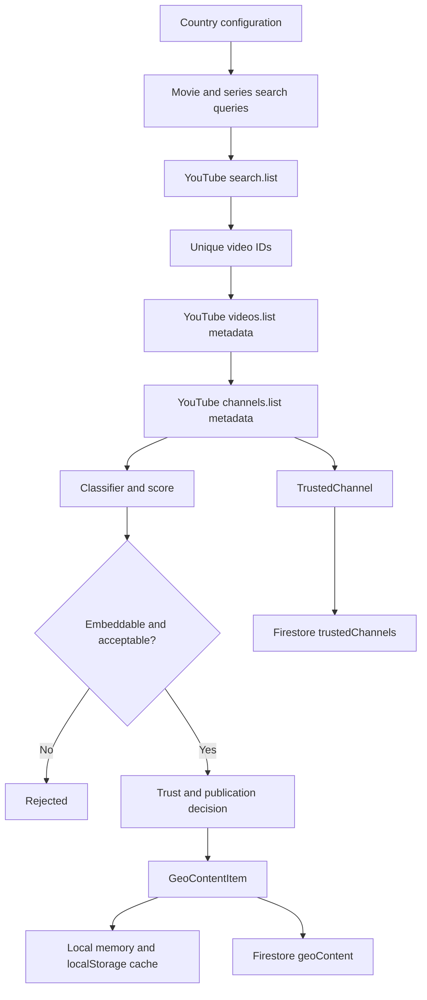

# OrangeFlix YouTube Geo Discovery Audit

This document describes the implemented YouTube geo-discovery system as it exists in the source code. It separates real behavior from intended behavior and identifies the configuration and production work required for reliable operation.

## 1. Purpose

The system discovers YouTube cinema content for configured territories, classifies each video as a movie, series, episode, trailer, clip, interview, music item, or unknown, associates it with a country, applies channel trust rules, and stores qualifying records in Firestore.

Current configured territories are:

- Rwanda (`RW`)
- Uganda (`UG`)
- Kenya (`KE`)
- Nigeria (`NG`)
- Ghana (`GH`)
- Tanzania (`TZ`)
- South Africa (`ZA`)
- United States / African-American and indie cinema (`US`)

Primary source files:

- `src/features/geo/countryConfig.ts`: country metadata, queries, trusted channel IDs
- `src/features/youtube/client.ts`: YouTube API client and metadata mapping
- `src/features/youtube/discoveryWorker.ts`: country scan orchestration
- `src/features/youtube/classifier.ts`: scoring and content classification
- `src/services/geo-content-service.ts`: caching, channel lifecycle, Firestore writes
- `src/services/auto-discovery-scheduler.ts`: scheduled and manual multi-country scans
- `src/components/admin/YouTubeGeoAdminTab.tsx`: admin controls
- `src/server/youtube-discovery.ts`: server-side gateway used by the Vite development middleware
- `firestore.rules`: authorization rules

## 2. End-to-End Flow



### Step sequence

1. A country is loaded from `countryConfig.ts`.
2. Its movie and series queries are combined.
3. Each query calls YouTube `search.list` with `part=id,snippet`, `type=video`, and up to 25 results.
4. Video IDs are deduplicated across all queries for that country.
5. IDs are sent to `videos.list` in batches of up to 50 with snippet, duration, statistics, and status data.
6. Unique channel IDs are sent to `channels.list` in batches of up to 50.
7. Each video is scored and classified using title, description, channel title, tags, duration, category, country, and channel trust.
8. Non-embeddable videos and rejected-channel videos are excluded.
9. New channels are represented as pending unless their ID is pre-approved in the country configuration.
10. Classified content and discovered channels are persisted by `GeoContentService`.
11. Public pages read published geo content; administrators review pending content and channels.

## 3. Country Configuration

Each `GeoCountryConfig` provides:

- `countryCode`
- display names and flag
- supported languages and default language
- region
- minimum movie duration
- `movieQueries`
- `seriesQueries`
- pre-approved `trustedChannelIds`
- categories and search suggestions
- enabled state

Queries are ordinary YouTube search strings. They are not guaranteed to return only local content. Country relevance is later checked by the classifier.

Administrators can add or toggle custom queries in `customQueries/{queryId}`. Active custom queries replace the default movie or series query list for that country when present.

## 4. YouTube API Usage

### Search

The client calls:

```text
GET https://www.googleapis.com/youtube/v3/search
```

Parameters include:

- `part=id,snippet`
- `type=video`
- `q=<configured query>`
- `maxResults=25`
- API key

A search request consumes YouTube quota. A full multi-country scan can issue dozens of search requests because every configured query is executed.

### Video metadata

The client calls `videos.list` with:

- `snippet`
- `contentDetails`
- `statistics`
- `status`

It extracts title, description, channel, thumbnail, publication date, duration, views, likes, category, embeddability, syndication, license, and tags.

### Channel metadata

The client calls `channels.list` with:

- `snippet`
- `statistics`

It extracts channel title, description, custom URL, thumbnail, country, publication date, subscriber count, and video count.

### Upload scanning

For a specific channel, the system derives the uploads playlist ID by replacing the `UC` prefix with `UU` and calls `playlistItems.list`. It falls back to a channel search if the playlist request returns no IDs.

## 5. Classification and Scoring

The classifier is heuristic. It does not verify copyright ownership, human review, or whether a video is genuinely a complete film.

### Positive signals

- Duration at least 60 minutes: `+35`
- Duration 45 to 59 minutes: `+20`
- Title contains `full movie`: `+25`
- Title contains `full film`: `+25`
- Country-specific full-movie phrase: `+25`
- Country-specific cinema term: `+20`
- Country metadata relevance: `+15` when relevance reaches 15
- Approved channel: `+20`
- YouTube movie category: `+10`

### Negative signals

- Trailer: `-50`
- Teaser: `-50`
- Clip, scene, highlight, or cut: `-40`
- Shorts or duration at most 60 seconds: `-50`
- Short film or short: `-30` when under 30 minutes
- Episode: `-25`
- Season/episode code: `-30`
- Season number: `-20`
- Interview: `-30`
- Behind the scenes: `-30`
- Reaction: `-30`
- Review or ending explained: `-25`
- Music video/audio/lyrics: `-25`
- Top 5/10/countdown: `-30`
- News: `-20`

### Content type resolution

- Episode markers produce `episode` unless the duration is at least 60 minutes, in which case the result is `series`.
- Trailer signals produce `trailer`.
- Clip/short/behind-the-scenes signals produce `clip`.
- Interview signals produce `interview`.
- Music-video signals produce `music`.
- Long videos with enough score become `movie`.
- Anything else remains `unknown`.

### Full movie candidate

A video can become `isFullMovieCandidate` only when:

- Classified as `movie`
- Duration is at least 45 minutes
- No disqualifying negative signal exists
- Channel is not rejected

Thresholds:

- At least 60 minutes and score at least 60
- 45 to 59 minutes and score at least 70
- Approved channel, score at least 45, and duration at least 45 minutes

`confidence` is a normalized score with a duration adjustment. It is not a probability and should not be presented as a verified quality or rights score.

## 6. Channel Trust Lifecycle

Channel trust values:

- `approved`: trusted source; qualifying content can be published automatically
- `pending`: discovered but awaiting administrator review
- `rejected`: excluded from discovery and content is rejected

A channel pre-listed in `trustedChannelIds` starts approved for that country. A newly discovered channel starts pending. The stored channel record contains publication toggles, approval metadata, notes, scan status, and indexed counts.

### Admin actions

- Add a channel by ID, handle, URL, or resolvable identifier
- Approve a channel
- Reject a channel
- Pause a channel back to pending
- Toggle automatic movie/series publishing
- Scan a channel uploads feed
- Bulk approve, reject, pause, or toggle channels

Approving a channel also scans its uploads and can promote qualifying existing content.

## 7. Publication Rules

For each video:

1. If it is not embeddable, reject it.
2. If its channel is rejected, reject it.
3. If it has a very low score and is unknown, reject it.
4. Approved-channel full movie candidates are published.
5. Approved-channel series and episodes are published.
6. Non-approved full movie candidates are published only when:
   - full movie candidate is true
   - score is at least 60
   - country score is at least 15
7. Other acceptable items remain `pending_review`.

Stored content status values:

- `published`
- `pending_review`
- `rejected`
- `unavailable`

Moderation values are:

- `approved`
- `pending_review`
- `rejected`

Important: `rightsVerified` is currently stored as `false`; YouTube metadata does not establish distribution rights.

## 8. Firestore Data Model

### `geoContent/{videoId}`

Stores the normalized `GeoContentItem`, including:

- YouTube IDs and watch URL
- title, slug, description, thumbnails
- channel ID and title
- duration and formatted duration
- views and likes
- publication and discovery timestamps
- country and language
- classification, score, confidence, and reasons
- full-movie flag
- embeddability and license fields
- channel trust
- rights verification state
- publication and moderation status
- tags

### `trustedChannels/{channelId}`

Stores channel identity, country, trust state, auto-publish toggles, approval details, scan status, scan statistics, notes, and indexed count.

### `customQueries/{queryId}`

Stores administrator-created search queries:

```text
id, countryCode, query, type, enabled, isDefault, createdAt
```

### `system_meta/auto_discovery`

Stores scheduler configuration, the last run timestamp, and the last summary log.

### Local caches

The service also stores content, channels, queries, and summaries in browser memory and localStorage. Local cache is not the source of truth and can become stale or differ between users.

## 9. Scheduling and Manual Operation

The scheduler configuration defaults to:

- enabled
- Monday, Wednesday, Friday
- 04:00 UTC
- automatic publish enabled
- completion notifications enabled

The current browser scheduler registers a timer for the next scheduled UTC slot. It does not intentionally scan when a user opens the app. A localStorage lock prevents duplicate runs from ordinary tabs on the same browser.

The admin dashboard can independently run a manual scan using `admin_manual`.

### Important operational limitation

A browser timer is not a reliable global cron service. The scheduled scan runs only if a browser tab remains open at the scheduled time. For guaranteed operation, move the scan to a server cron, Cloud Scheduler, GitHub Actions schedule, Firebase scheduled function, or Vercel Cron endpoint.

## 10. Quota and Rate Limiting

YouTube `search.list` is the expensive operation. A multi-country scan runs every configured query for every country, so quota exhaustion is expected when the query set is large.

Current protections:

- Country scans run sequentially.
- There is a 1.2-second pause between countries.
- A country worker stops after a `429` or `rateLimitExceeded` result.
- The multi-country scheduler stops remaining countries after quota exhaustion.
- Video and channel detail requests are batched up to 50 IDs.

Current limitations:

- No server-wide distributed lock exists.
- No durable job queue exists.
- No quota budget check exists before starting.
- No retry-after/backoff strategy exists.
- Search queries are not globally deduplicated across countries.
- The browser can still call YouTube directly when a Vite key is present.

Recommended production approach: run one server-side worker, limit each country to a small curated query set, cache search results, and stop before the quota budget is exhausted.

## 11. Security and Production Audit Findings

### High priority

1. `VITE_YOUTUBE_API_KEY` is a browser-exposed credential. Any visitor can inspect and reuse it. Use only a restricted public key for development, or remove the `VITE_` path and force all YouTube calls through the server.
2. `VITE_BREVO_API_KEY` has the same browser-exposure problem. Brevo email sending should be server-side.
3. The Vite `/api/geo-discovery` endpoint exists only as development middleware in `vite.config.ts`. There is no matching `api/geo-discovery` Vercel function in the repository, so the client fallback is not a complete production deployment path.
4. The browser scheduler cannot guarantee a scheduled scan when no user has the site open.

### Medium priority

1. Firestore rules allow public reads for `geoContent` and `trustedChannels`, but writes are admin-only. Ensure every discovery writer is server-side or authenticated as an admin.
2. The classifier publishes content from approved channels without human approval when thresholds are met.
3. `rightsVerified` remains false and there is no rights-review workflow.
4. Browser localStorage can make admin counts and public discovery views appear inconsistent until cache refresh.
5. The setup script verifies Firestore connectivity but intentionally does not create collections or seed records. This is correct for a real-data policy.

## 12. Required Environment Variables

Client-safe Firebase configuration:

```env
VITE_FIREBASE_API_KEY=
VITE_FIREBASE_AUTH_DOMAIN=
VITE_FIREBASE_PROJECT_ID=
VITE_FIREBASE_STORAGE_BUCKET=
VITE_FIREBASE_MESSAGING_SENDER_ID=
VITE_FIREBASE_APP_ID=
```

Server-only values:

```env
YOUTUBE_API_KEY=
FIREBASE_SERVICE_ACCOUNT_KEY={...}
BREVO_API_KEY=
```

Do not use `VITE_YOUTUBE_API_KEY` or `VITE_BREVO_API_KEY` for production secrets.

## 13. Admin Operating Procedure

1. Confirm the Firebase project and Authentication providers are correct.
2. Confirm the operator account has a real `/users/{uid}` document with `isAdmin: true` and `role: admin`.
3. Deploy `firestore.rules`.
4. Add only real trusted channels from official or authorized sources.
5. Keep new channels pending until reviewed.
6. Use a small number of high-signal queries per territory.
7. Run a single-country manual scan first.
8. Review pending channels and content before broad publication.
9. Monitor YouTube quota and stop scans when quota is exhausted.
10. Check `geoContent` records for embeddability, correct country, classification, and rights status.
11. Run scheduled discovery from a server job, not from normal visitor browsers.
12. Rotate exposed API keys and service-account keys immediately if they appear in source, browser logs, screenshots, or chat.

## 14. What “Working Correctly” Means

A healthy scan should show:

- Search requests returning HTTP 200
- Non-zero unique video IDs when matching content exists
- Metadata and channel details fetched successfully
- A visible split between published and pending-review content
- Trusted channels saved with the correct country and trust state
- Firestore writes succeeding as an authenticated admin or trusted server
- No repeated `429` quota errors
- No Firestore permission errors
- No API secrets in browser bundles or request URLs

A scan that returns zero content because YouTube quota is exhausted is an API quota failure, not proof that no cinema exists. A scan that returns pending content is an expected moderation result, not a failed scan.

## 15. Recommended Next Engineering Steps

1. Add a production `api/geo-discovery` serverless endpoint.
2. Move all YouTube calls to the server and remove `VITE_YOUTUBE_API_KEY` usage.
3. Move Brevo calls to a server endpoint and rotate all exposed credentials.
4. Add a real scheduled job with a distributed lock and durable run history.
5. Add quota-aware budgeting and exponential backoff.
6. Add automated tests for classifier thresholds and publication decisions.
7. Add Firestore emulator tests for public, owner-private, member-reply, and admin permissions.
8. Add rights and moderation fields that require explicit human approval before publication.
9. Add server-side cache or persisted search cursors to reduce repeated query costs.
10. Add monitoring for search quota, metadata failures, rejected counts, pending backlog, and Firestore write failures.
